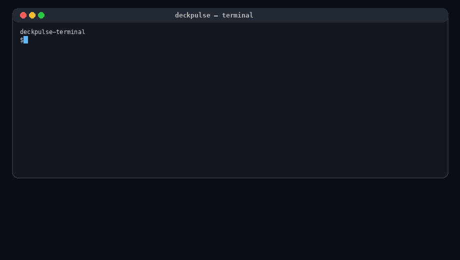
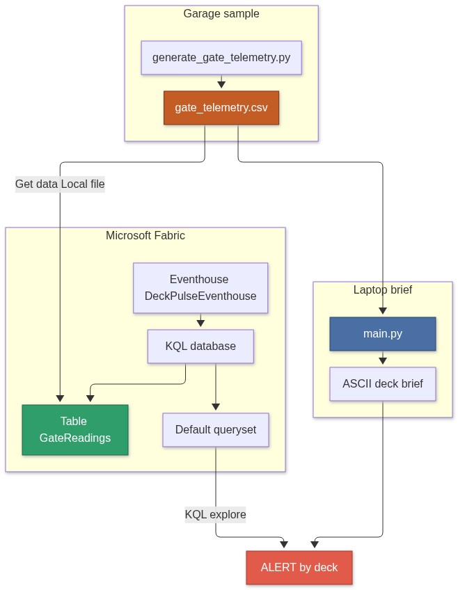
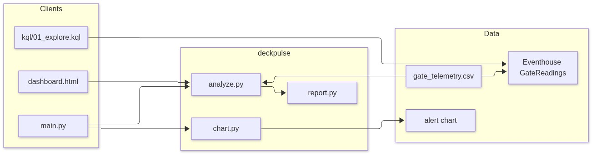
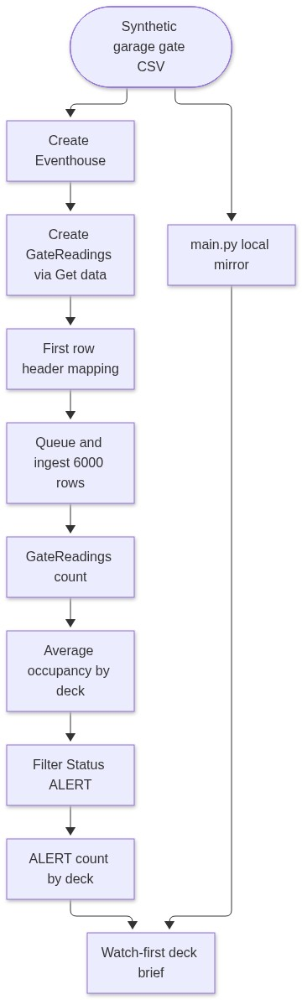
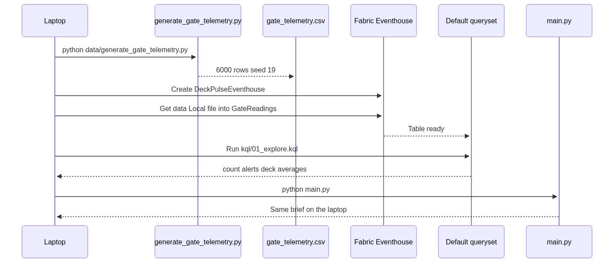

# DeckPulse

**How I Ingested Parking-Garage Gate Occupancy into a Fabric Eventhouse and Queried Near-Full Alerts**

DeckPulse is an experimental PoC. It generates a 6,000-row garage gate CSV, mirrors the same brief on a laptop, and documents the Fabric Eventhouse create-and-ingest path so those readings can be queried with KQL.



## Why this experiment

I wanted a practical garage-ops story for Eventhouse work. Gate occupancy, wait seconds, and throughput readings that a parking desk might triage during a busy window. The laptop brief and the KQL queryset are meant to agree on the same counts.

## What you get



1. Synthetic CSV: `data/gate_telemetry.csv` (seed 19, 6,000 rows)
2. Local brief: `python main.py`
3. KQL explore script: `kql/01_explore.kql`
4. Fabric ingest notes: `docs/eventhouse-ingest.md`
5. Optional FastAPI dashboard: `uvicorn api:app --reload`

## Sample results (seed 19)

| Metric | Value |
| --- | --- |
| Rows | 6,000 |
| ALERT rows (`OccupancyPct > 88`) | 229 |
| Alert rate | 3.82% |
| Watch first | Midtown (83 ALERT) |
| Peak reading | gate-006 at 100.00% on Midtown |

Deck averages from the laptop brief:

| Deck | Avg occupancy % | Readings | ALERT |
| --- | --- | --- | --- |
| Campus | 62.36 | 597 | 22 |
| River | 62.33 | 1,168 | 52 |
| Plaza | 61.83 | 1,751 | 72 |
| Midtown | 61.75 | 2,484 | 83 |

Campus leads on average occupancy. Midtown leads on alerts. The watch order follows the spikes.

## Architecture



## Quick start

```bash
git clone https://github.com/aniket-work/DeckPulse.git
cd DeckPulse
python3 -m venv .venv
source .venv/bin/activate
pip install -r requirements.txt
python data/generate_gate_telemetry.py
python main.py --chart images/alert-chart.png
pytest -q
```

Optional dashboard:

```bash
uvicorn api:app --reload
```

Open `http://127.0.0.1:8000/`.

## Fabric Eventhouse path



Full steps live in [`docs/eventhouse-ingest.md`](docs/eventhouse-ingest.md). Short version:

1. Create Eventhouse `DeckPulseEventhouse`
2. Use **Get data** → **Local file**
3. Create table `GateReadings`
4. Upload `data/gate_telemetry.csv` with first-row headers
5. Run `kql/01_explore.kql` in the default queryset

## Sequence



## Project layout

```text
DeckPulse/
├── README.md
├── main.py
├── api.py
├── requirements.txt
├── deckpulse/
│   ├── analyze.py
│   ├── chart.py
│   └── report.py
├── data/
│   ├── generate_gate_telemetry.py
│   └── gate_telemetry.csv
├── kql/
│   └── 01_explore.kql
├── docs/
│   └── eventhouse-ingest.md
├── static/
│   └── dashboard.html
├── tests/
│   └── test_brief.py
└── images/
```

## License

MIT
